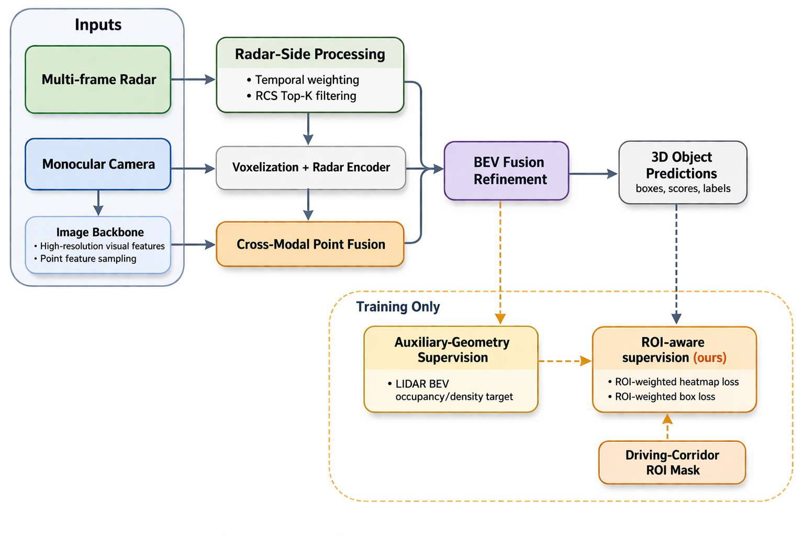

# Radar-Centric 3D Detection with LiDAR-Guided Geometry Supervision

A radar + monocular camera 3D object detector built on CenterPoint and evaluated on [View-of-Delft](https://intelligent-vehicles.org/datasets/view-of-delft/). LiDAR is used **only during training**, as a privileged geometry signal; inference runs on radar and camera alone.
Course project for TU Delft RO47020 *Advanced Machine Perception* (Mar–Apr 2026). Authors: Ruifang Zhang, Lude Krikke, Emile de Kam.

**Result (validation split):** driving-corridor (ROI) mAP **53.59 → 65.75**; entire-area mAP **31.96 → 42.80** (43.55 for the best entire-area variant).



## Problem

Radar is attractive for driving perception: it works in bad weather, measures velocity directly and is cheap. But its point cloud is sparse and noisy. In our data analysis, only **~0.2% of radar points fall inside ground-truth boxes**, and pillar occupancy is ~0.75%. The target metric is detection inside the **driving corridor (ROI)**.

## Method

1. **Radar-adapted CenterPoint backbone**: down-weight vertical regression in the loss, widen Circle-NMS and Gaussian heatmap radii for pedestrians and cyclists (radar multipath / ghost detections), add 3D radial distance as an input feature, and use a two-layer pillar encoder with average pooling.
2. **Radar strengthening**: multi-frame radar input with recency-based weighting of RCS and radial velocity, a normalised time encoding, and RCS-based Top-K point selection inside each pillar.
3. **Radar-camera fusion**: ResNet-18 layer-2/3 features are sampled at projected radar points (cross-modal point fusion), then a BEV fusion module refines the radar BEV with image-guided cues.
4. **LiDAR-guided geometry supervision (training only)**: an auxiliary branch predicts LiDAR BEV occupancy/density targets. This strengthens the backbone and is removed at inference.
5. **ROI-aware fine-tuning**: objects whose centres fall inside the driving corridor get a weight λ_roi > 1 in both the classification and the box-regression loss.

## Results

All ablations are on the validation split, with 12 epochs per model. Time is the average training time per epoch on the same hardware and batch size.

**Main model evolution** (each row adds one component on top of the previous row)

| Method | Entire mAP | ROI mAP | Time / epoch |
|---|---:|---:|---:|
| Radar baseline | 31.96 | 53.59 | 2:15 |
| + Radar-adapted backbone | 33.17 | 54.53 | 3:75 ¹ |
| + Radar-camera BEV fusion | 37.55 | 61.91 | 6:05 |
| + Radar strengthening | 39.34 | 63.18 | 6:20 |
| + High-res image features | 41.79 | 63.79 | 6:40 |
| + LiDAR geometry supervision | **43.16** | 64.78 | 7:01 |
| + ROI-aware fine-tuning | 42.80 | **65.75** | 8:31 |

¹ As printed in the report.

**ROI fine-tuning ablation**

| Variant | Entire mAP | ROI mAP |
|---|---:|---:|
| LiDAR geometry supervision | **43.16** | 64.78 |
| + Full ROI-aware weighting | 42.80 | **65.75** |
| + Bbox-only ROI weighting | 42.37 | 65.09 |
| + Heatmap-only ROI weighting | 42.96 | 64.84 |
| + Class-aware ROI weighting | 41.72 | 64.22 |

**Alternatives that did not beat the final model**

| Variant | Entire mAP | ROI mAP |
|---|---:|---:|
| ROI-aware geometry supervision | 43.34 | 64.35 |
| Camera prior | **43.55** | 64.59 |
| Camera prior (pedestrian only) | 42.59 | 64.64 |
| Radar BEV self-attention (training time 8:31 → 10:00 / epoch) | 41.55 | 63.55 |

**Takeaways**
- Every step contributes. The largest late-stage gain comes from **training-time LiDAR geometry supervision**, which costs nothing at inference.
- Weighting *both* classification and box regression inside the ROI works best. Weighting only one of them, or reweighting per class, is weaker.
- Heavier supervision or extra architecture (camera prior, self-attention) can raise entire-area mAP but is less reliable for the driving-corridor objective.

**Limitations**
- Single seed, and model selection on the validation split. Differences under ~1 mAP should not be over-read.
- LiDAR teacher → radar student feature distillation was also tried (see [docs/experiment-log-zh.md](docs/experiment-log-zh.md)). It did not beat the auxiliary-geometry approach and is not part of the final model.

## My role

Built the radar-camera fusion pipeline (point fusion, BEV fusion, high-res image features), the LiDAR geometry supervision and the ROI-aware supervision. Integrated all components into one training and evaluation framework, ran the experiments, and wrote the corresponding sections of the report.

## Repository layout

This repo contains the project code only. It is an overlay on top of the RO47020 starter code, which is not redistributed here.

```text
src/
  model/fusion/            Point & BEV gated fusion, temporal radar encoder, LiDAR geometry aux head, ...
  model/image_backbones/   ResNet-18 (up to layer3) image branch
  config/                  Hydra configs, one YAML per experiment in the results table
  tools/                   Data analysis, training sanity checks, training-curve visualisation
patches/                   My changes to starter-code files (detector, head, dataset, train/eval/test)
scripts/                   Cluster launch scripts, weight download
docs/                      Experiment log, baseline record, architecture notes
figures/                   Architecture diagrams (Graphviz sources included)
```

The biggest patch is [`patches/model__detector__centerpoint.py.patch`](patches/model__detector__centerpoint.py.patch) (+1.3k lines). It wires the image branch, fusion, ROI weighting and distillation into the detector.

## Reproduce

```bash
# 1. Start from the RO47020 starter code (course material, not included), then add this repo on top
cp -r radar-camera-fusion-vod/src/. <starter_code>/src/
cd <starter_code> && git apply /path/to/radar-camera-fusion-vod/patches/*.patch

# 2. Environment: Python 3.9, CUDA 12.x, PyTorch 2.7, PyTorch Lightning 2.6, Hydra
cd src/ops/cpp_pkgs && python setup.py develop && cd -
python /path/to/radar-camera-fusion-vod/scripts/download_weights.py   # ResNet-18 ImageNet weights

# 3. Dataset: request access on the View-of-Delft site, place under data/view_of_delft/
#    lidar/  radar/  radar_3frames/  radar_5frames/

# 4. Train / evaluate
python src/tools/train.py --config-name fusion_finetune_layer3_stable_radar_to_lidar_big3_roi_train_weight
python src/tools/eval.py checkpoint_path=outputs/<exp_id>/checkpoints/<ckpt>.ckpt
```

Runs were trained on a single A100 MIG slice (1g.10gb).

## Acknowledgements

The baseline CenterPoint code and the evaluation scaffolding (not included) are by the TU Delft RO47020 course team. View-of-Delft is by Palffy et al. (RA-L 2022); please follow the dataset's own license.
