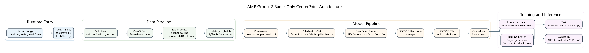

# Radar-Camera Fusion for 3D Object Detection on View-of-Delft

Improving a radar-only CenterPoint detector on the [View-of-Delft](https://intelligent-vehicles.org/datasets/view-of-delft/) dataset with image fusion, temporal radar cues and ROI-aware training.
Course project for TU Delft RO47020 *Advanced Machine Perception* (Mar–Apr 2026).

**Result (validation set, single seed):** Entire-area mAP **31.96 → 43.55** (+11.59); driving-corridor (ROI) mAP **53.59 → 65.75** (+12.16).


<!-- TODO: 加一张 fusion 版本的结构图，或 BEV 预测 vs GT 的可视化 -->

## Problem

Radar is robust in bad weather and cheap, but its point cloud is extremely sparse. In my data analysis, only **~0.2% of radar points fall inside ground-truth boxes**, and pillar occupancy is ~0.75%.
The starting point is a radar-only CenterPoint (PillarFeatureNet → PointPillarsScatter → SECOND → SECONDFPN → CenterHead, ~5.6M params) provided by the course. The task is to improve it. The baseline code itself is **not** included in this repo (see [Reproduce](#reproduce)).

## What I built

1. **Point-level image fusion**: radar points are projected into the camera image, ResNet-18 features are sampled at those locations, and a learned gate injects them into the radar features.
2. **Unified coordinate frame**: radar and image features are fused in the LiDAR frame. This single change gave one of the largest jumps (+2.2 mAP).
3. **Radar-side structure & temporal input**: deeper voxel encoder, class-wise target radii, 3-frame radar with temporal decay, and RCS Top-K point selection per voxel.
4. **"big3" upgrade**: lightweight BEV fusion on top of point fusion, an explicit temporal radar encoder, and a LiDAR occupancy auxiliary head used only at training time.
5. **ROI-aware training**: loss weighting toward the driving corridor and a camera-based prior.
6. **LiDAR teacher → radar student distillation**: the infrastructure works, but it has **not yet improved the best student** (see Limitations).

## Results

Validation set, single seed (47020). For each experiment, the best checkpoint is chosen on validation mAP. The full log, including per-class numbers and failed attempts, is in [docs/experiment-log-zh.md](docs/experiment-log-zh.md) (Chinese).

| Step | Change | Entire mAP | ROI mAP |
|---|---|---:|---:|
| Baseline | radar-only CenterPoint | 31.96 | 53.59 |
| + image (frozen) | `fusion_freeze` | 32.59 | 54.67 |
| + gated fusion | `centerpoint_radar_gated_fusion_v2` ¹ | 33.82 | 57.37 |
| + fine-tune image layer3 | `fusion_finetune_layer3` | 34.35 | 57.33 |
| + training stabilisation | `fusion_finetune_layer3_stable` | 35.37 | 58.71 |
| + unified LiDAR frame | `..._stable_radar_to_lidar` | 37.55 | 61.91 |
| + radar structure & 3-frame radar | `..._main_struct_radar_changes` ¹ | 41.34 | 64.18 |
| + high-res image features | `..._ped_highres` | 41.79 | 64.59 |
| + BEV fusion, temporal encoder, LiDAR aux | `..._big3` | 43.16 | 64.78 |
| + ROI training weights | `..._big3_roi_train_weight` | 42.80 | **65.75** |
| + camera prior | `..._big3_roi_train_weight_camera_prior` | **43.55** | 64.59 |
| *Reference: LiDAR teacher* | `lidar_teacher` | 43.81 | 60.78 |

¹ The config for this run is not included in this snapshot.

**Takeaways**
- Adding an image branch is not enough by itself (+0.6). The gains come from *how* it is fused, and above all from putting everything in **one geometric frame**.
- The radar student ends up roughly on par with a LiDAR-only teacher on the entire area, and beats it on ROI (65.75 vs 60.78).
- Optimising for entire-area mAP and for ROI mAP are not the same thing; the best model depends on which one you choose.

**Limitations**
- Single seed only, and checkpoint selection on the validation set. Small differences (< ~1 mAP) are within noise.
- LiDAR-guided distillation reached +1.29 entire-area mAP over the student it started from, but lost ROI mAP. On a later, stronger student it lowered both metrics. It is still an open direction.

## Repository layout

This repo contains only my own code. It is an overlay on top of the RO47020 starter code, which is not redistributed here.

```text
src/
  model/fusion/            Point & BEV gated fusion, temporal radar encoder, LiDAR geometry aux head, ...
  model/image_backbones/   ResNet-18 (up to layer3) image branch
  config/                  Hydra configs, one YAML per experiment in the results table
  tools/                   Data analysis, training sanity checks, training-curve visualisation
patches/                   My changes to starter-code files (detector, head, dataset, train/eval/test)
scripts/                   Cluster launch scripts, weight download
docs/                      Experiment log, baseline record, architecture notes
figures/                   Architecture diagrams (Graphviz sources included)
```

The biggest patch is [`patches/model__detector__centerpoint.py.patch`](patches/model__detector__centerpoint.py.patch) (+1.3k lines). It wires the image branch, fusion, ROI weighting and distillation into the detector.

## Reproduce

```bash
# 1. Start from the RO47020 starter code (course material, not included), then add this repo on top
cp -r radar-camera-fusion-vod/src/. <starter_code>/src/
cd <starter_code> && git apply /path/to/radar-camera-fusion-vod/patches/*.patch

# 2. Environment: Python 3.9, CUDA 12.x, PyTorch 2.7, PyTorch Lightning 2.6, Hydra
cd src/ops/cpp_pkgs && python setup.py develop && cd -
python /path/to/radar-camera-fusion-vod/scripts/download_weights.py   # ResNet-18 ImageNet weights

# 3. Dataset: request access on the View-of-Delft site, place under data/view_of_delft/
#    lidar/  radar/  radar_3frames/  radar_5frames/

# 4. Train / evaluate
python src/tools/train.py --config-name fusion_finetune_layer3_stable_radar_to_lidar_big3_roi_train_weight
python src/tools/eval.py checkpoint_path=outputs/<exp_id>/checkpoints/<ckpt>.ckpt
```

Runs were trained on a single A100 MIG slice (1g.10gb).

## Acknowledgements

The baseline CenterPoint code and the evaluation scaffolding (not included) are by the TU Delft RO47020 course team. View-of-Delft is by Palffy et al. (RA-L 2022); please follow the dataset's own license.
