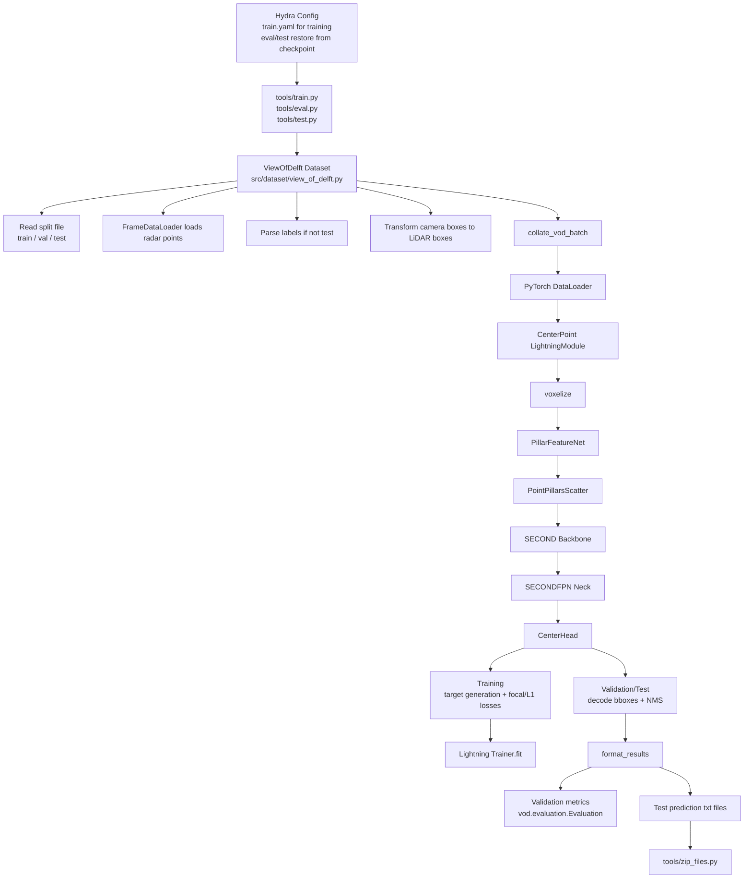
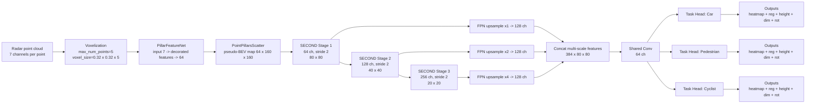
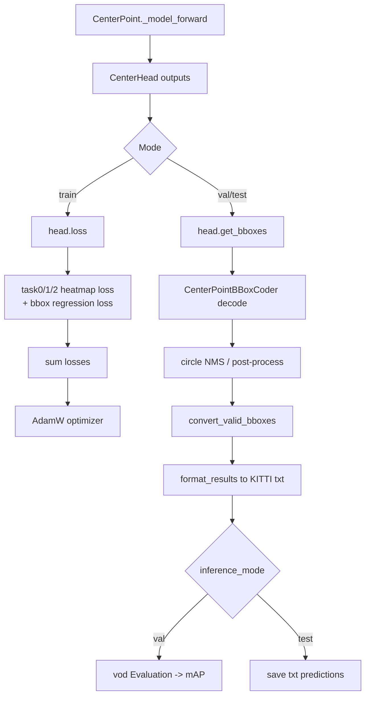

# Architecture Diagram

This document summarizes the actual code structure under `src/`.
The project is a radar-only 3D object detection pipeline built around `CenterPoint`.

## 1. Overall System Flow

## 2. Model Internal Architecture

## 3. Training / Inference Split

## 4. Key Source Mapping

- `src/tools/train.py`: training entry point, builds dataset, dataloader, model, and trainer.
- `src/dataset/view_of_delft.py`: loads VoD radar data and labels, then converts boxes to LiDAR coordinates.
- `src/model/detector/centerpoint.py`: top-level assembly and train/val/test logic.
- `src/model/voxel_encoders/pillar_encoder.py`: pillar feature encoding.
- `src/model/middle_encoders/pillar_scatter.py`: sparse pillar to dense BEV pseudo-image.
- `src/model/backbones/second.py`: SECOND backbone.
- `src/model/necks/second_fpn.py`: multi-scale FPN fusion.
- `src/model/heads/centerpoint_head.py`: multi-task detection head, loss, and bbox decoding.
